# customer-segmentation-kmeans
Behavioural segmentation of 5,000 fashion-retail customers with K-means, benchmarked against Hierarchical, GMM and DBSCAN (Python, scikit-learn)
# Urban Tee – Customer Segmentation with K-Means

**Who are a fashion retailer's customers, and which offer should each group get?**
Behavioural segmentation of 5,000 customers of Urban Tee (T-shirts, online + offline stores) to raise repeat purchases and order value while cutting wasted promotion spend.

## Key findings

- **Demographics do not explain buying behaviour.** Age and income have ~0 correlation with spend, and segments do not differ by city, channel or payment method (chi-square p = 0.20 / 0.66 / 0.17) → segment on **behaviour**, not demographics.
- **Four behavioural segments (K-Means, K = 4):** the top segment is **22% of customers but 39% of revenue**.
- **Profit leak:** the two highest-volume segments also use discounts the most (38–43%), so promotion cost is concentrated on customers who would buy anyway.
- **Price per item is the key feature.** Two segments buy the same number of T-shirts (~11–12 a year) but at 554k vs 274k VND per item; without this engineered feature they would merge into one group.

| Segment | % customers | % revenue | Profile | Strategy |
|---|---|---|---|---|
| Loyal trendsetters | 22% | 39% | 24 T-shirts/yr, 518k/item, discount use 43% | Replace discounts with VIP perks (early access, milestone gifts) |
| Deal hunters | 29% | 29% | 22 T-shirts/yr, 328k/item, discount use 38% | Bundles (buy 3 get 15% off) to lift order value |
| Budget occasionals | 25% | 12% | 12 T-shirts/yr, 274k/item | Short-expiry vouchers via low-cost channels (email, Zalo) |
| Selective quality buyers | 24% | 20% | 11 T-shirts/yr, 554k/item, discount use 15% | New-collection alerts and service; no discount codes |

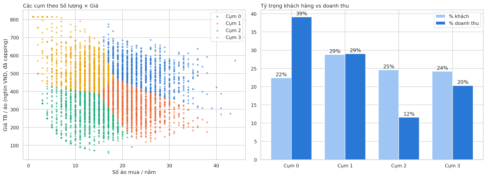

## Approach

1. **Data quality:** 5,000 customers, 9 columns, no missing values or duplicates; 32.5% of customers recorded at exactly 18 years old and 15% at exactly 5m VND income → likely floor values at data entry
2. **EDA:** distributions, channel and city mix, correlation; found discount usage and number of items correlated at r = 0.99 (near-duplicate variables)
3. **Features:** number of items, total spend, and an engineered **price per item**; dropped discount rate (duplicate) and demographics. Capped price per item at the IQR upper bound (skew 2.11 → 0.30), then standardised
4. **Choosing K:** Elbow, Silhouette and Davies–Bouldin, plus business usability (3–5 segments are actionable for a small retailer) → K = 4
5. **Profiling & testing:** segment profiles, revenue share, chi-square tests against city, channel and payment
6. **Strategy:** one offer and KPI set per segment, tied to the three business goals

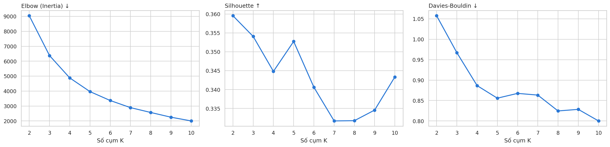

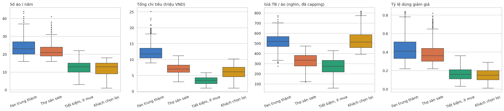

## Model validation

| Algorithm | Clusters | Silhouette ↑ | Davies–Bouldin ↓ | Agreement with K-Means (ARI) |
|---|---|---|---|---|
| **K-Means** | 4 | **0.345** | **0.887** | 1.00 |
| Hierarchical (Ward) | 4 | 0.300 | 1.019 | 0.58 |
| GMM | 4 | 0.263 | 1.208 | 0.47 |
| DBSCAN | 2 | 0.506 | 0.406 | 0.00 |

- **K-Means is best on every metric among 4-cluster solutions**, and Hierarchical finds a similar structure (ARI 0.58) → the segments are stable, not an artefact of one algorithm.
- **DBSCAN's higher silhouette is a trap:** it puts 97% of customers in one cluster; the other 72 customers are exactly those capped at 816k per item. **A model should not be chosen on one metric alone.**
- Silhouette stays ~0.34 for every K → customers form a continuum rather than natural clusters, so K-Means is used as practical **segmentation for marketing**, not cluster discovery.

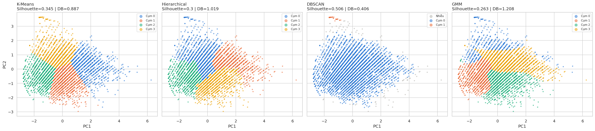

**Demographic vs behavioural segmentation:** clustering on age + income + spend produces two segments that sit at the average on every behaviour; clustering on behaviour gives four segments with distinct profiles.

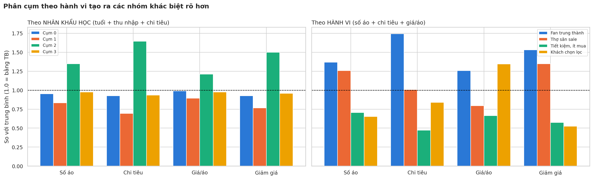

## Limitations

- Possible data-entry floors (age 18, income 5m, spend 1m VND)
- No purchase dates or order counts → RFM and churn could not be computed
- Recommended offers need A/B testing before roll-out
- Chart labels are in Vietnamese (segment names: Fan trung thành = Loyal trendsetters, Thợ săn sale = Deal hunters, Tiết kiệm ít mua = Budget occasionals, Khách chọn lọc = Selective quality buyers)

<b>▶ More charts (EDA and visualisation)</b>

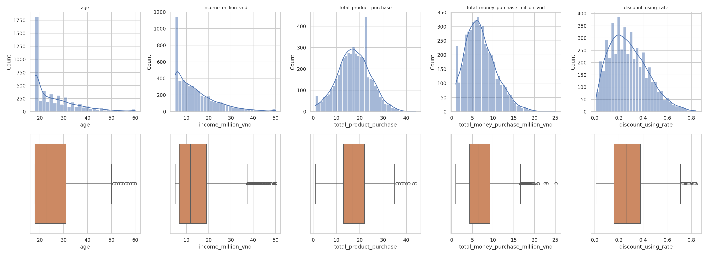
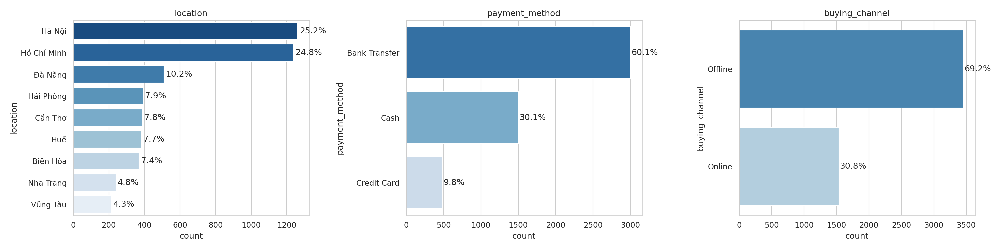
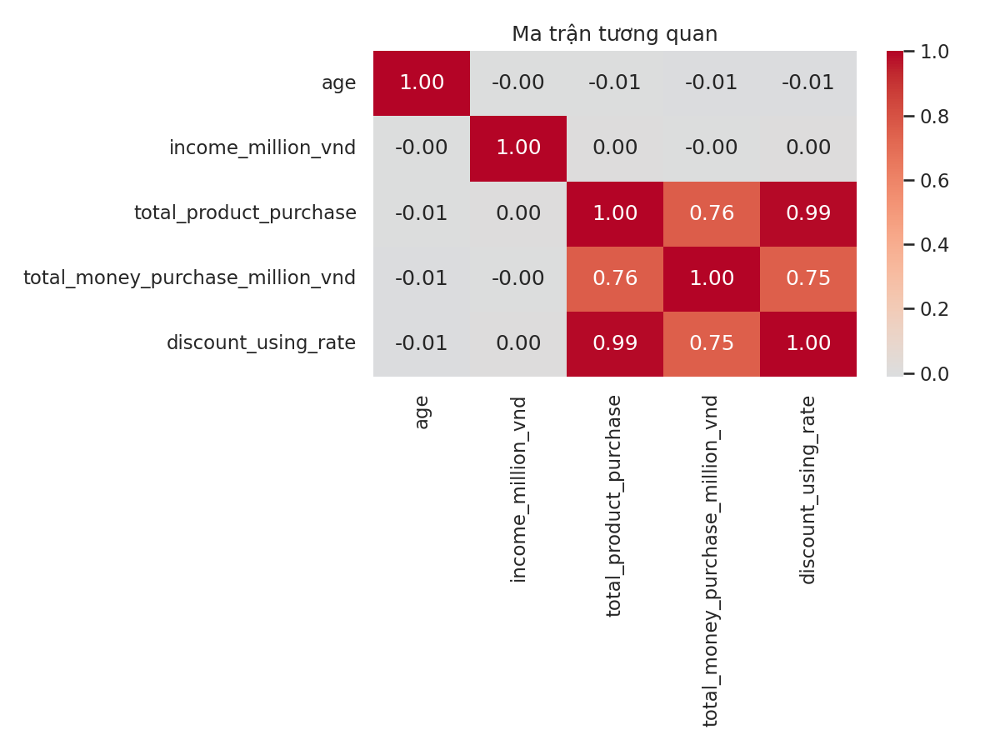
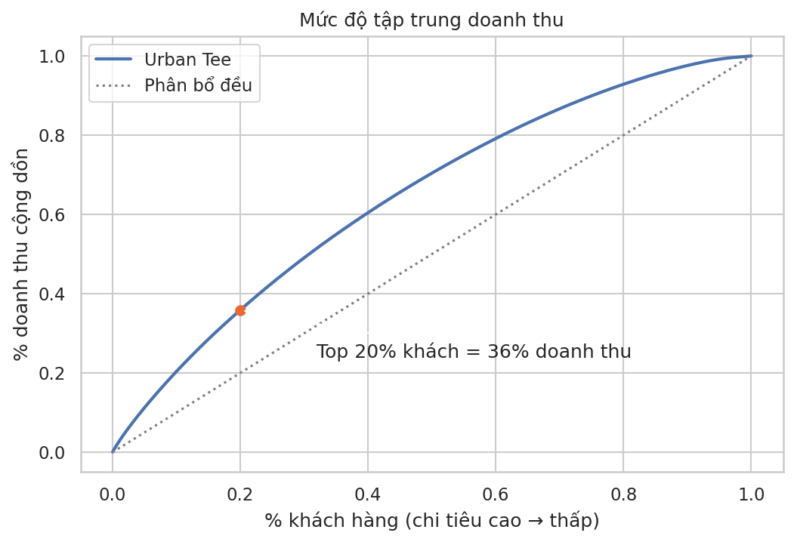
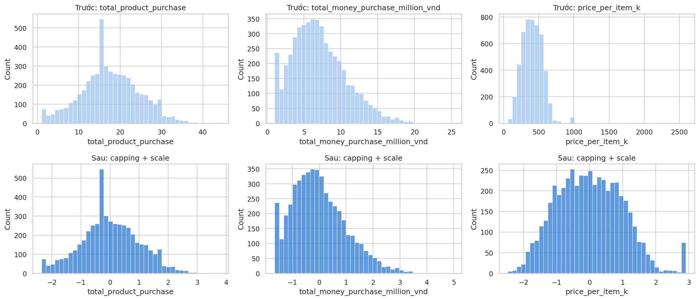
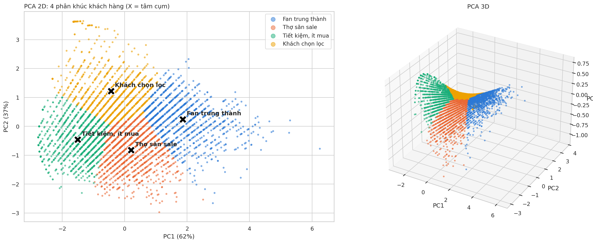
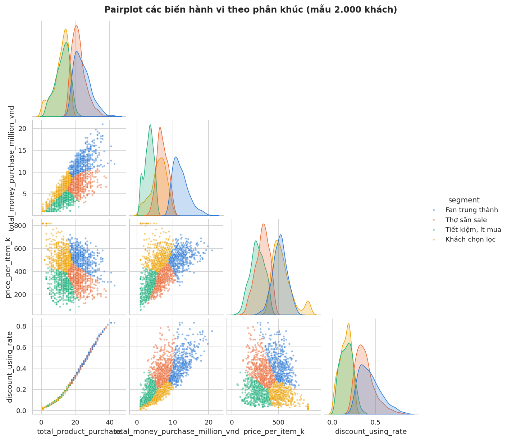
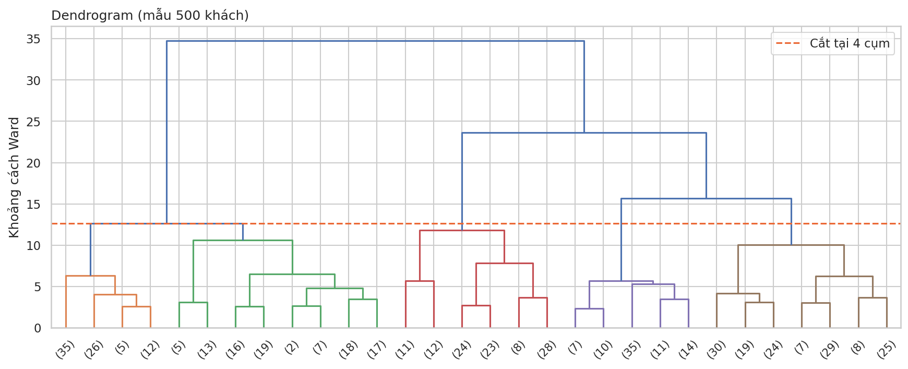
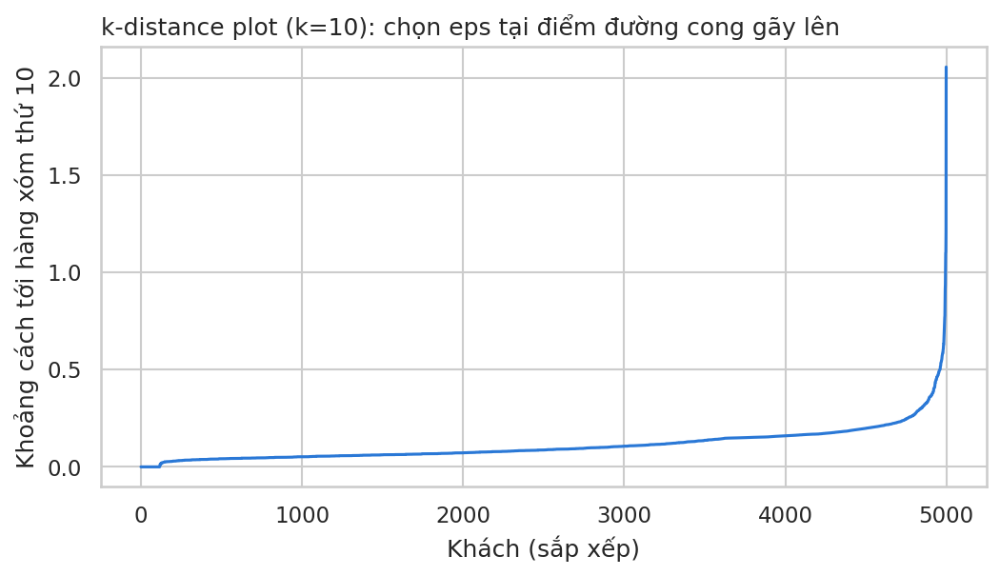

## Data & how to run

Data not included (course material from Tomorrow Marketers). The notebook `urban_tee_customer_segmentation.ipynb` shows all outputs and charts.

Tools: Python (pandas, scikit-learn, SciPy, matplotlib, seaborn) · Google Colab

---
*Tran Bao Phuc · phuctran120116@gmail.com*
